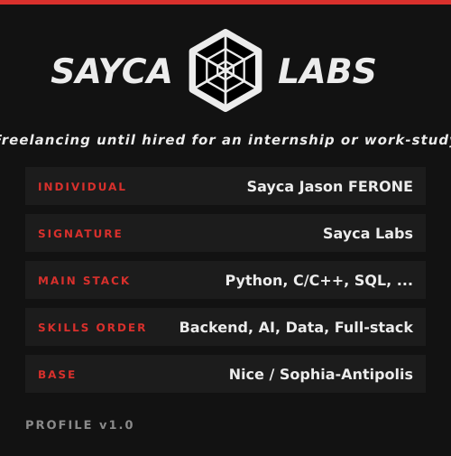
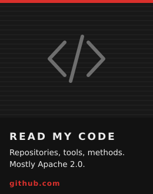
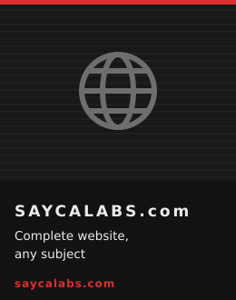
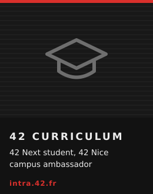
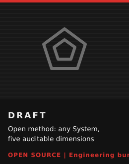
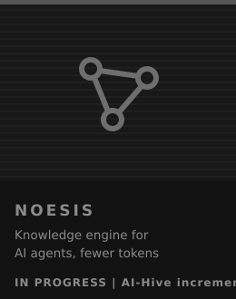
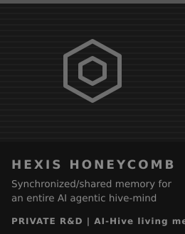
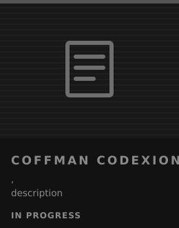

  

  

  
  
  
  

### `// PROJECTS`

  
  
  
  

### `// BACKGROUND`

Former French Navy petty officer, sonar operator then team leader, now in the
42 Next curriculum at 42 Nice (RNCP level 7 / EQF level 7). I bring operational
rigor and documentation discipline, and I model a problem before I code it.
Freelance through [Sayca Labs](https://saycalabs.com/).

### `// HOW I WORK`

| Principle | In practice |
|---|---|
| **No standard limitation** | I never reject a method because it is unusual: conventional judgement is what hides breakthrough solutions. |
| **Contracts first** | Each unit is specified before it is built, so blocks assemble into a System that scales. |
| **Keep what was learned** | Every hour of reasoning, human or AI, is captured in a reusable form instead of being lost. |
| **Self-documenting projects** | Humans and AI agents share the same written sources of truth. |

Ethics charter: [English](ETHICS.md) | [French](ETHICS.fr.md)

<!-- Visual assets: edit the CONTENT section of assets/build.py, then run it. -->
