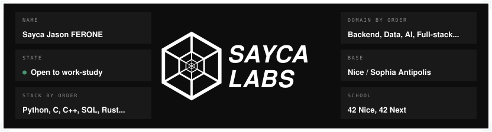
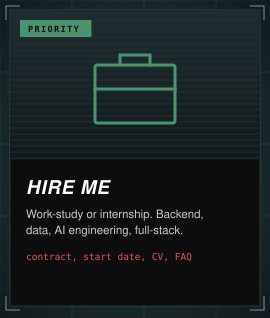
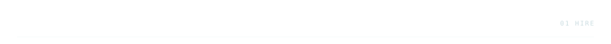
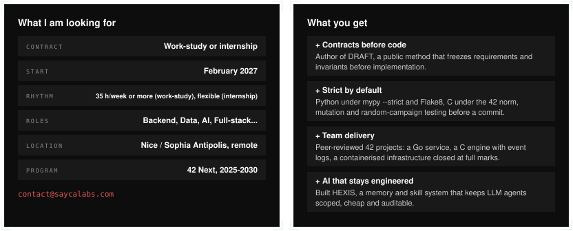
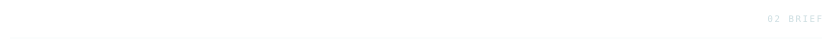
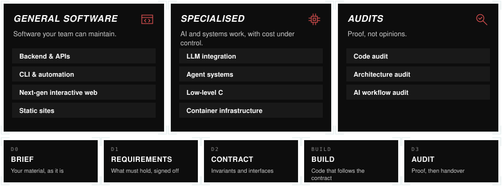
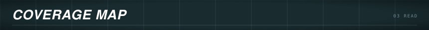
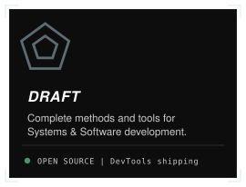
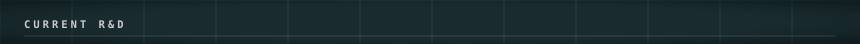
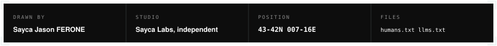

  

  <b>Open to a 6-month internship or a 12-24 month work-study (alternance) 
  from January 2027 - Nice / Sophia-Antipolis</b> 
  Ex-French Navy sonar team leader. Author of DRAFT, an open systems method.
  I model a System before I code it.

  
  
  

<b><code>// WHICH CONTRACT, WHICH TEAMS, WHICH CODE</code></b>

| Question | Answer |
|---|---|
| Which contract and rhythm? | Work-study (alternance) or internship, from February 2027. Work-study: 35 hours a week, more where the contract allows. Internship: flexible hours. |
| Which teams fit best? | Backend and data teams first, then AI engineering and full-stack work. Anything where correctness is measured. |
| Can I see code? | Most repositories are public under Apache 2.0 on [github.com/sayca-jferone](https://github.com/sayca-jferone). |

  Price on quote. Describe the need in the
  <a href="https://saycalabs.com/#brief">brief composer</a> or write to
  <a href="mailto:contact@saycalabs.com">contact@saycalabs.com</a>.

  
  
  

  
  

<b><code>// HOW I WORK</code></b>

| Principle | In practice |
|---|---|
| **No standard limitation** | I never reject a method because it is unusual: conventional judgement is what hides breakthrough solutions. |
| **Contracts first** | Each unit is specified before it is built, so blocks assemble into a System that scales. |
| **Keep what was learned** | Every hour of reasoning, human or AI, is captured in a reusable form instead of being lost. |
| **Self-documenting projects** | Humans and AI agents share the same written sources of truth. |

  
  
  

  Ethics charter: <a href="ETHICS.md">English</a> - <a href="ETHICS.fr.md">French</a>

