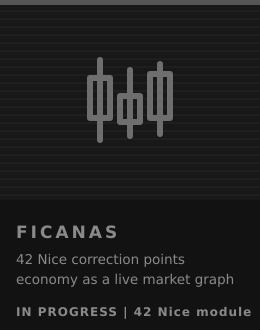
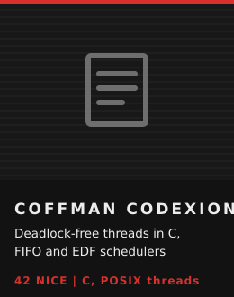

  

  <b>Open to a 6-month internship or a 12-24 month work-study (alternance) 
  from January 2027 - Nice / Sophia-Antipolis</b>

  

<h2 align="center">MAIN STACK</h2>

 

<h2 align="center">CURRENT PROJECTS</h2>

  
  
  

<h2 align="center">CURRENT R&D</h2>

  
  

<h2 align="center">BACKGROUND</h2>

Former French Navy petty officer, sonar operator then team leader, now in the
42 Next curriculum at 42 Nice. I bring operational rigor and documentation
discipline, and I model a problem before I code it. Freelance through
[Sayca Labs](https://saycalabs.com/).

<b><code>// HOW I WORK</code></b>

| Principle | In practice |
|---|---|
| **No standard limitation** | I never reject a method because it is unusual: conventional judgement is what hides breakthrough solutions. |
| **Contracts first** | Each unit is specified before it is built, so blocks assemble into a System that scales. |
| **Keep what was learned** | Every hour of reasoning, human or AI, is captured in a reusable form instead of being lost. |
| **Self-documenting projects** | Humans and AI agents share the same written sources of truth. |

<h2 align="center">CONTACT</h2>

<h3 align="center">ETHICS CHARTER</h3>

> [English document](ETHICS.md)
>
> [French document](ETHICS.fr.md)
