<h1 align="center"></h1>

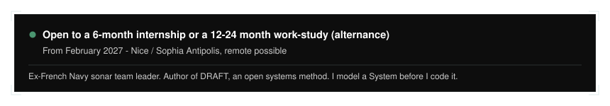

  
  <a href="https://saycalabs.com/#brief">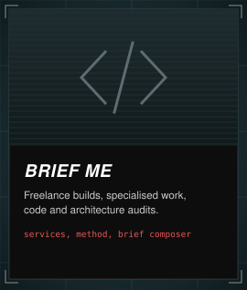</a>
  <a href="https://saycalabs.com/#readme">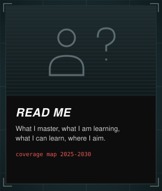</a>

<h2 align="center"></h2>

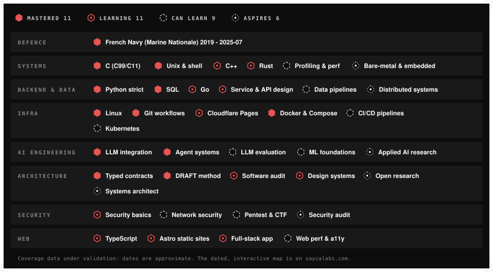

<h3 align="center"></h3>

  
  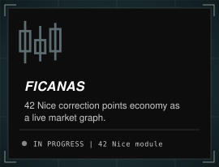
  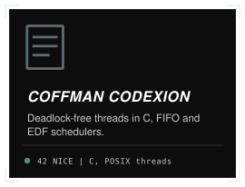

<h3 align="center"></h3>

  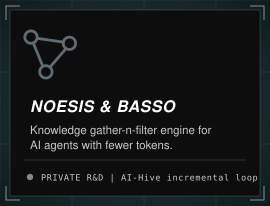
  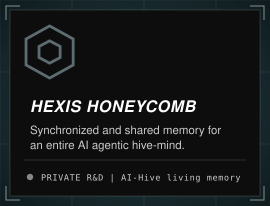

<h3 align="center"></h3>

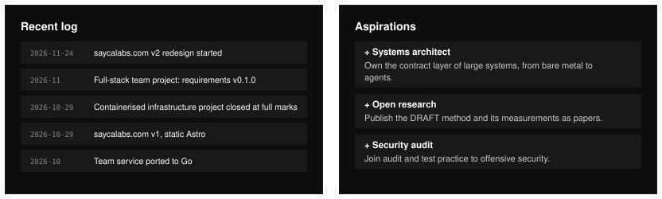

<h3 align="center">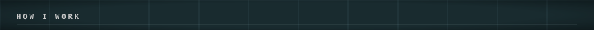</h3>

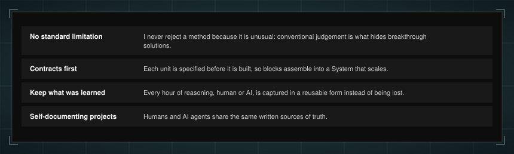

<h3 align="center">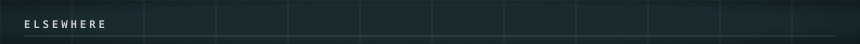</h3>

  <a href="https://saycalabs.com/">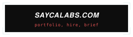</a>
  <a href="https://linkedin.com/in/sayca">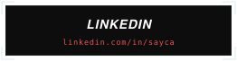</a>
  <a href="https://profile.intra.42.fr/users/jferone">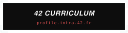</a>

  <a href="ETHICS.md">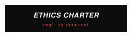</a>
  <a href="ETHICS.fr.md">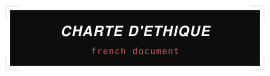</a>

Sayca Jason FERONE (Sayca Labs) - software and systems engineering student at 42 Nice, ex-French Navy sonar team leader, based in Nice / Sophia Antipolis. Backend, data, AI engineering, full-stack, low-level C. Open to work-study or internship from February 2027. <a href="https://saycalabs.com/">saycalabs.com</a> - contact@saycalabs.com

